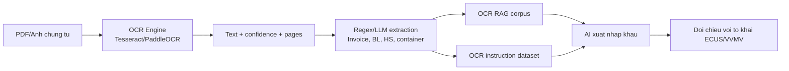

# Runbook OCR cho chung tu xuat nhap khau

## 1. Muc tieu

Them lop OCR de doc cac chung tu nhu:

- Commercial Invoice
- Packing List
- Bill of Lading / AWB / MAWB / HAWB
- Certificate of Origin
- Customs Declaration scan
- Sales Contract

OCR output duoc chuan hoa thanh JSONL, sau do dua vao RAG va training dataset.

## 2. Trang thai moi truong hien tai

Da co:

- `tesseract` 5.5.2
- ImageMagick `magick`
- `ghostscript` 10.07.0
- Tesseract language `vie` va `eng`

Lenh da dung de cai:

```bash
brew install tesseract-lang
brew install ghostscript
```

## 3. OCR mot thu muc chung tu

```bash
cd /Volumes/FastVault-Apps/Projects/ai-vvmv
source venv/bin/activate

python scripts/ocr_documents.py \
  --input /path/to/documents \
  --output llm-dataset/ocr-assets/ocr_documents.jsonl \
  --recursive \
  --lang eng
```

Sau khi co `vie`:

```bash
python scripts/ocr_documents.py \
  --input /path/to/documents \
  --output llm-dataset/ocr-assets/ocr_documents.jsonl \
  --recursive \
  --lang vie+eng
```

## 4. Output OCR

Moi dong JSONL gom:

- `document_id`
- `source_file`
- `document_type`
- `avg_confidence`
- `extracted_fields`
- `text`
- `pages`

Vi du field duoc trich xuat:

- `invoice_no`
- `bl_no`
- `declaration_no`
- `tax_code`
- `incoterm`
- `currency`
- `hs_codes`
- `containers`
- `amount_candidates`

## 5. Dua OCR vao RAG/training

```bash
python scripts/ocr_to_rag.py \
  --input llm-dataset/ocr-assets/ocr_documents.jsonl \
  --output-dir llm-dataset/ocr-assets
```

Output:

```text
llm-dataset/ocr-assets/private_rag/ocr_corpus.jsonl
llm-dataset/ocr-assets/training/ocr_instruction_tuning.jsonl
llm-dataset/ocr-assets/reports/ocr_assets_summary.json
```

## 6. Kien truc ket hop voi AI xuat nhap khau



## 7. Khuyen nghi chat luong

- Scan 200-300 DPI, nen thang trang, khong nghieng.
- Tach tung loai chung tu neu co the.
- Dung `vie+eng` cho chung tu song ngu Viet/Anh.
- Neu OCR confidence thap hon 70, bat buoc human review.
- Dung RAG de doi chieu OCR voi to khai: invoice no, BL, HS, tri gia, container.
